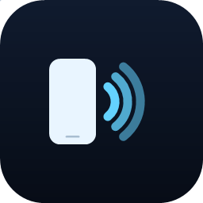
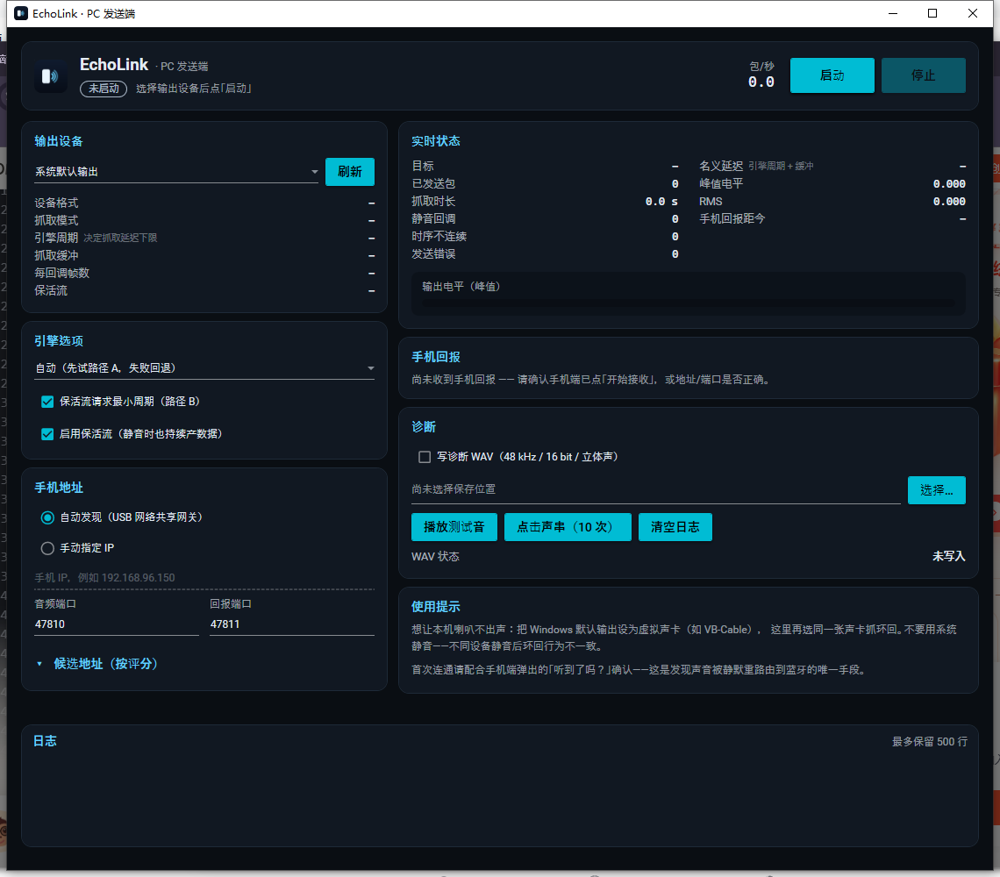
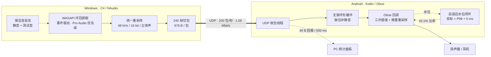

<div align="center">



# EchoLink

**把手机当电脑音响。**
电脑的声音，从手机放出来——USB 网络共享、裸 PCM over UDP、50–70 ms 端到端。

[](docs/build.md)
[](pc/)
[](pc/src/EchoLink.App)
[](android/)
[](android/)
[](android/app/src/main/cpp)
[](#实测数据)
[](#验证状态)
[](docs/protocol.md)

</div>

---

## 这是什么

笔记本喇叭坏了、电脑没有音响、或者你想让声音从客厅的手机出来？EchoLink 把**任意 Windows 电脑的系统声音**
实时送到**安卓手机**播放，走 USB 数据线（USB 网络共享），不装驱动、不走蓝牙。

- PC 端用 WASAPI **环回抓取**系统输出，统一转 48 kHz / 16 bit / 立体声，每 5 ms 打一个 976 字节的裸 PCM 包
- 手机端用 **Oboe** 低延迟播放，靠**自适应目标水位 + 微量重采样**吸收两端时钟漂移
- **不重传、不握手**：丢包补静音保持时间线连续，稳定性交给闭环而不是网络层

## 特性

| | |
| --- | --- |
| 🎧 **低延迟** | 设计工作点 50–70 ms（端到端，看 P99 不看均值）；USB 主路径，Wi-Fi 备用不承诺延迟 |
| 🔌 **零驱动** | 只依赖 Windows 自带 WASAPI + 手机 USB 网络共享；不需要虚拟声卡也能用 |
| 🧭 **免配置寻址** | 自动从 USB 网络适配器的**默认网关**找到手机，不写死 IP、不区分 RNDIS/NCM |
| 🩺 **可观测** | 手机端实时显示水位、目标水位、抖动 P50/P99、欠载、重采样比率、Oboe 缓冲、独占失败码 |
| 🛡️ **断流自愈** | 错误回调 / 回调停摆 / 路由变化都会自动重开流；开流后核对实际参数 |
| 🎵 **不爆音** | 缺包补静音、积压丢帧带淡入、重采样偏差限 ±0.1%（不可闻） |

## 界面

<table>
<tr>
<td width="62%"></td>
<td>

**PC 端**：WPF + [Material Design in XAML](https://github.com/MaterialDesignInXAML/MaterialDesignInXamlToolkit)，
深色主题与手机端同色系。左侧配置、右侧实时状态，底部日志。

**手机端**：Jetpack Compose，水位曲线 + 链路参数 + 稳定性计数，
首连会弹测试音确认。

</td>
</tr>
</table>

## 架构



包结构（详见 [docs/protocol.md](docs/protocol.md)）：

```
偏移 0   seq: u32            每包 +1
偏移 4   sampleCount: u64    本包首帧的绝对帧号（接收端据此补静音、保持时间线）
偏移 12  timestamp: u32      采集时刻 µs（用于算到达抖动，差分后与绝对时钟无关）
偏移 16  PCM: 960 B          240 帧 × 2 声道 × 16 bit
```

## 快速开始

### 1. PC 端

```powershell
git clone <this-repo> && cd EchoLink
.\scripts\build-pc.ps1            # 产出 artifacts\pc\EchoLink.App.exe
.\artifacts\pc\EchoLink.App.exe
```

> 需要 .NET 8 Desktop Runtime。想完全免安装：`.\scripts\build-pc.ps1 -SelfContained`。

### 2. 手机端

```powershell
.\scripts\build-android.ps1       # 产出 debug APK（自带调试签名）
C:\Android\Sdk\platform-tools\adb.exe install -r .\artifacts\echolink-arm64-debug.apk
```

> 手机需开启 **开发者选项 → USB 调试**；只开 USB 网络共享时 `adb` 看不到设备。

### 3. 连起来

1. 手机：打开 **USB 网络共享** → 打开 EchoLink → **开始接收**
2. PC：选择输出设备 → 手机地址保持「自动发现」→ **启动**
3. 首次连通手机端会播一声 1 kHz 测试音，**请用耳朵确认**（这是发现"被静默重路由到蓝牙"的唯一手段）

> 💡 想让本机喇叭不出声：把 Windows 默认输出设为虚拟声卡（如 VB-Cable），PC 端抓它的环回。
> **不要用系统静音**——不同设备静音后环回行为不一致。

## 实测数据

PC 链路自检（本机 Windows 10 22H2，5 分钟连续运行）：

```
收包统计：包 60196，字节 58751296，畸形 0，
  序号跳变 0，累计采样数跳变 0，
  到达间隔 P50 0.75ms / P90 10.25ms / P99 10.25ms，
  实际速率 199.7 包/秒
结果: OK
```

- **零丢包、零乱序、零畸形**，速率稳定 200 包/秒
- P99 到达间隔 = 10.25 ms，正好是共享引擎周期——PC 端是**成批**投递的，这也是手机端水位下限的由来
- 两端线格式用**真实抓包字节**做了互操作测试（[InteropVectorTest](android/app/src/test/java/com/echolink/app/InteropVectorTest.kt)）

完整的"改了什么、为什么、测出什么"记录在 [docs/verification.md](docs/verification.md)，
包括路径 A 被驱动拒绝（`0x88890021`）、路径 B 拿不到更小周期这些负面结论。

## 参数与设计取舍

| 参数 | 值 | 为什么 |
| --- | --- | --- |
| 采样率 / 位深 | 48 kHz / 16 bit / 立体声 | 安卓 44.1 kHz 直开往返约 160 ms，48 kHz 低延迟路径约 20 ms |
| 包大小 / 包率 | 976 B / 200 包/秒 | 5 ms 粒度，避免大包造成的排队延迟 |
| 目标水位 | 30 ms 起步 → P99+5 ms，clamp **[20, 60]** ms | 下限 20 ms 是为了跨过 PC 端 10 ms 成批发包间隔 |
| 水位硬下限 | 20 ms，并自动抬到 `Oboe 缓冲 × 1.15` | 环里必须够一次回调取走 |
| 重采样偏差 | ±0.1%，一阶低通 + 斜率限幅 | 听不出音高变化（约 1.7 音分） |
| 丢帧阈值 | >2× 目标水位，带 2.5 ms 淡入 | 频繁丢帧比偶尔多半帧延迟更可闻 |
| 开流策略 | 独占→共享 三级降级，逐级记错误码 | 多数设备独占失败是采样率不匹配 |

## 项目结构

```
EchoLink/
├─ pc/                          Windows 发送端（.NET 8 + NAudio）
│  ├─ src/EchoLink.Core/        WASAPI 环回、重采样、打包、UDP、寻址、引擎
│  ├─ src/EchoLink.App/         WPF 仪表盘（Material Design in XAML，MVVM）
│  └─ tools/EchoLink.Diagnostics/  无界面诊断工具（devices/targets/capture/echo/sink/send）
├─ android/                     安卓接收端（Kotlin + Compose + Oboe）
│  └─ app/src/main/cpp/         无锁环形缓冲、漂移补偿、Oboe 流
├─ assets/                      图标（由 scripts/gen-icon.ps1 生成）
├─ docs/                        协议 / 设计 / 构建 / 测试 / 实测记录
└─ scripts/                     构建与图标生成脚本
```

## 验证状态

| 项目 | 状态 |
| --- | --- |
| PC 环回 → 重采样 → 打包 → UDP，5 分钟零丢包 | ✅ 通过 |
| 两端线格式字节级一致（真实抓包向量） | ✅ 单元测试 |
| 安卓构建 / 单元测试（21 项） | ✅ 通过 |
| USB 网关自动发现（真实 RNDIS 链路） | ✅ 实测命中 |
| 真机出声 | ✅ 通过 |
| 端到端延迟 P50/P99（三设备录音法） | ⬜ 待测 |
| 2 小时浸泡收敛 | ⬜ 待测 |
| 设备矩阵（MMAP 可用 / 不可用各一台） | ⬜ 待测 |

## 已知限制

- **不承诺 Wi-Fi 延迟**，USB 网络共享是主路径。
- **发现不了静默重路由**（声音被系统偷偷送到蓝牙等），只能靠首次测试音 + 人工确认。
- 目标水位偏低时可能仍偶发欠载；当前正按真机反馈调参（见 [docs/verification.md §2.7](docs/verification.md)）。
- 未做：自研虚拟声卡、按进程抓取、Opus 压缩（均在路线图阶段 4）。

## 文档

| 文档 | 内容 |
| --- | --- |
| [协议](docs/protocol.md) | 线格式唯一权威（包结构、端口、抖动定义） |
| [设计](docs/architecture.md) | 线程模型、WASAPI 细节、漂移闭环数学、四项加固 |
| [构建](docs/build.md) | 环境要求、签名、安装、常见问题 |
| [测试](docs/testing.md) | 延迟测量、浸泡、干扰、设备矩阵的可执行步骤 |
| [实测记录](docs/verification.md) | 每一条结论背后的真实数字，含失败与修正过程 |

## 致谢

- [Oboe](https://github.com/google/oboe) —— 安卓低延迟音频
- [NAudio](https://github.com/naudio/NAudio) —— 设备枚举与音频工具
- [Material Design in XAML](https://github.com/MaterialDesignInXAML/MaterialDesignInXamlToolkit) —— PC 端界面
- [scrcpy](https://github.com/Genymobile/scrcpy) —— 平滑水位的思路来源
- Fons Adriaensen，《Controlling adaptive resampling》—— 水位闭环的理论参考

## 许可证

[GPL-3.0](LICENSE) © 2026 Creat319

本项目以 GNU General Public License v3.0 发布。你可以自由使用、修改、分发，
但如果分发修改后的版本，必须同样以 GPL-3.0 开源并附带源码。

> 为什么是 v3 而不是 v2：本项目的依赖里有 Apache-2.0 组件
> （Oboe、Jetpack Compose、MaterialDesignThemes 等），
> Apache-2.0 与 GPLv2 不兼容，与 GPLv3 兼容。

---

<div align="center"><sub>图标与界面均由代码生成 · <code>scripts/gen-icon.ps1</code></sub></div>
